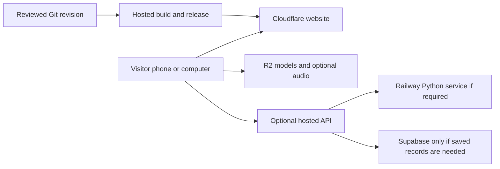

# Hosting plan — public availability without the Mac

Researched **12 November 2026, Hanoi time**. Status: **recommended preparation plan**, not a purchased service, deployed app, capacity benchmark or team-approved backend decision. Prices below are USD/month before tax unless stated otherwise. Recheck the actual account quote before subscribing.

## Recommended setup

**Use Cloudflare Workers Static Assets for the prepared React/TypeScript/Vite frontend, and R2 Standard for larger 3D/data/audio assets. Add Workers Paid only when a lightweight API is needed. Add Railway Pro in Singapore only if the agreed calculations require a Python/native-library backend.**

This is the best-value fit I recommend for the currently known requirements: phone/computer access, realistic interactive 3D, optional music/SFX, and availability independent of the development Mac. It is not a measured claim that one provider is fastest. The final product, traffic and data contract remain unchosen.

| Part | Initial choice | When it earns its cost |
|---|---|---|
| Website and application code | Workers Static Assets: $0 for ordinary asset serving | Needed from the first public release; no continuously running server required. |
| Models, textures, data and optional audio | R2 Standard: usage-based, with a free allowance | Use for files above the static-asset limit, media needing byte ranges, or independently updated assets. Small ordinary assets can stay with the frontend. |
| Small API | Workers Paid: $5 minimum | Add for API logic or scheduled lightweight work; omit if the whole first version works statically or the backend handles everything. |
| Python/shared calculations | Railway Pro: $20 minimum including $20 resource usage | Add only for required server-side work and shared team operation. It is not $20 plus the first $20 of usage. |
| Login and saved records | Supabase Pro: from $25, one Micro project covered | Optional; do not add accounts/database merely because the service exists. |

Sources: [static assets](https://developers.cloudflare.com/workers/static-assets/billing-and-limitations/), [Workers prices](https://developers.cloudflare.com/workers/platform/pricing/), [R2 prices](https://developers.cloudflare.com/r2/pricing/), [Railway plans](https://docs.railway.com/pricing/plans), [Supabase pricing](https://supabase.com/pricing).

The visitor's device draws the 3D scene. Hosting supplies files and any shared computation; a premium visual style alone does not require renting a GPU. Once deployed, neither viewing the app nor running its hosted backend depends on this Mac. Hosted builds can publish reviewed updates from Git. A native mobile wrapper later would add its own distribution requirements; this plan covers the responsive web app. [Client/server roles](https://developer.mozilla.org/en-US/docs/Learn_web_development/Extensions/Server-side/First_steps/Client-Server_overview), [Cloudflare builds](https://developers.cloudflare.com/workers/ci-cd/builds/)

## Costs to budget

**Recommended planning envelopes:** $5–10/month for the frontend plus a small API; $25–35 with a modest team Python backend; about $50–60 if we also need Supabase Pro. These are starting budgets, not caps or traffic forecasts. A purely static version can have $0 hosting within relevant allowances. Avoid a paid database, idle worker process or GPU until the actual workload justifies it.

Allow a separate **$10–25/year domain budget** as an estimate, not a registrar quote: the name/TLD and renewal price are unchosen. Tax, exchange/card fees, email delivery, paid monitoring, extra projects/environments, AI inference and separately running job workers are excluded from the figures. A paid monitoring service would also require its own quote.

### Transparent asset/API scenarios

Constructed assumptions: 20 MB of R2 assets per cold visit, 40 R2 reads per visit, 20 GB-month of stored assets, five dynamic API calls per visit at 10 ms CPU each, and fewer than 1M Class A storage operations/month. No browser/CDN cache savings are assumed. Builds stay within allowance, there is no other account usage, and additional HEAD/range/retry requests are excluded. These assumptions are not measurements of the future app.

| Cold visits/month | Asset transfer | R2 reads | Workers Paid | R2 Standard | Combined |
|---|---:|---:|---:|---:|---:|
| 10,000 | 200 GB | 0.4M | $5.00 | $0.15 | **$5.15** |
| 100,000 | 2,000 GB | 4M | $5.00 | $0.15 | **$5.15** |
| 1,000,000 | 20,000 GB | 40M | $5.40 | $10.95 | **$16.35** |

R2 internet egress has no per-GB fee; its storage and operations are still billed. The first 10 GB-month, 1M Class A operations (including writes/listing) and 10M Class B reads are included monthly. Above those, Standard costs $0.015/GB-month, $4.50/M Class A operations and $0.36/M Class B operations, with billing-unit rounding. Workers Paid includes 10M requests and 30M CPU ms; excess costs $0.30/M requests and $0.02/M CPU ms. Thus the million-visit row includes $0.40 additional CPU and $10.80 additional reads. [R2 calculation rules](https://developers.cloudflare.com/r2/pricing/), [Workers calculation rules](https://developers.cloudflare.com/workers/platform/pricing/)

This is a billing illustration, not proof that a specific calculation handles a million visits. Larger assets, repeated downloads, range requests, bots, expensive calculations and independent services change the bill. Smaller mobile assets remain necessary even when transfer is inexpensive.

### Optional backend examples

Railway bills actual container resource use: $10/GB-month RAM, $20/vCPU-month CPU, $0.05/GB outgoing traffic and $0.15/GB-month persistent volumes. Its $20 Pro floor includes usage; additional services share the account bill. The examples use approximate published monthly equivalents, not reserved machine sizes; actual metering and month length can change the total. [Resource rates](https://docs.railway.com/pricing/plans)

| Assumed continuous monthly average | Resource calculation | Railway Pro bill | With the $5.15 frontend/API example |
|---|---:|---:|---:|
| 1 GB RAM, 0.1 vCPU, 10 GB egress; no volume | $10 + $2 + $0.50 = $12.50 | **$20 minimum** | **$25.15** |
| 2 GB RAM, 0.25 vCPU, 10 GB egress; no volume | $20 + $5 + $0.50 = $25.50 | **$25.50** | **$30.65** |

If the backend replaces the small Worker API entirely, remove the $5 Workers subscription from those examples. Do not route bulk assets through Railway: R2 serves them directly. RAM-heavy terrain/native-library work may need more than these examples; measure peak memory, CPU time and concurrency on the real calculation before promising capacity. Start one service and keep autoscaling bounded.

## Limits that affect this app

| Area | Verified limit or behavior | Planned response |
|---|---|---|
| Cloudflare static files | 25 MiB/file; 20,000 files/version Free or 100,000 Paid | Put oversized models/data in R2; split or reduce assets for phones rather than relying on enormous downloads. |
| Worker computation | 128 MB per isolate, shared across concurrent requests. Free: 100k dynamic requests/day and 10 ms CPU/request. Paid HTTP CPU: 30 s default, up to 5 min. | Keep edge logic small. Test actual library compatibility; use a normal Python container when memory/native dependencies demand it. |
| Safari media | Static Assets currently returns full responses rather than HTTP 206 byte ranges | Serve media requiring ranges through R2 and verify seeking/playback on actual Safari. This hosting route is researched, not yet tested. |
| Production asset URL | `r2.dev` is rate/bandwidth limited and intended for development; custom domains enable caching | Use an asset subdomain with HTTPS, explicit cache rules and appropriate CORS. Verify model/audio responses, cache hits and MIME types. |
| Cloud builds | Workers Free: 3,000 minutes/month; Paid: 6,000, then $0.005/min. 20-minute build timeout | Keep the Node/lockfile pinned and use hosted builds. Do not turn the Mac into the release server. |

Sources: [Workers limits](https://developers.cloudflare.com/workers/platform/limits/), [Range limitation](https://developers.cloudflare.com/workers/static-assets/billing-and-limitations/), [R2 public buckets](https://developers.cloudflare.com/r2/buckets/public-buckets/), [build limits](https://developers.cloudflare.com/workers/ci-cd/builds/limits-and-pricing/).

Preserve normal asset-first serving. Running the Worker before every file consumes dynamic usage; the separate **Workers Caching** feature also bills cache-hit requests, including static assets. It is different from ordinary free asset delivery or R2 CDN caching. Do not enable it merely because its name sounds beneficial. Workers Paid is also separate from a Cloudflare zone Pro/Business subscription. [Billing distinctions](https://developers.cloudflare.com/workers/platform/pricing/)

## Why this over the alternatives

| Alternative | Current cost/limit evidence | When I would choose it |
|---|---|---|
| **Vercel Pro** | $20/month including one deployer and $20 usage credit; additional deployers $20 each. Flat CDN includes 1M requests/1 TB; another $20/month buys 10M requests/50 TB. Six deployers therefore start at $120 before a CDN upgrade/other usage. | Strong alternative if the team settles on Next.js/Vercel-specific workflows or already operates there. Current Vite frontend does not need those features. |
| **Netlify Pro** | $20 base with 3,000 credits and unlimited members; bandwidth uses 20 credits/GB, requests 2 credits/10k, production deploys 15 credits. Base-Pro recharge is $10/1,500 credits. | Convenient team previews, but media-heavy delivery consumes its credit pool quickly. Higher tiers need an account quote. |
| **Render paid backend** | Single-member Hobby workspace $0 plus compute: $7 for 512 MB/0.5 CPU, $25 for 2 GB/1 CPU. Pro workspace is another $25 with unlimited members. Hobby/Pro include 5/25 GB transfer, then $0.15/GB. | Prefer it if fixed instance sizing is more useful than metered CPU/RAM. A shared team with a 2 GB service starts at $50 before frontend/overages; 512 MB must not be assumed sufficient for scientific libraries. |
| **Railway Pro backend** | $20 usage-inclusive minimum, metered resources and no per-seat charge; Singapore available | Recommended optional team backend for ordinary Python/native-library work, with measured limits and Serverless/App Sleeping disabled for a continuously warm API. |

Sources: [Vercel Pro](https://vercel.com/docs/plans/pro-plan), [Vercel flat CDN](https://vercel.com/docs/pricing/flat-rate-cdn), [Netlify prices](https://www.netlify.com/pricing/), [Render prices](https://render.com/pricing), [Railway pricing](https://railway.com/pricing), [Railway regions](https://docs.railway.com/deployments/regions), [Railway sleep behavior](https://docs.railway.com/deployments/serverless).

Vercel's new flat-CDN offer improves its value, but eligibility excludes large-scale media/file delivery that dominates bandwidth; this app's unbuilt asset mix has not been classified. Under eligible recurring usage and one deployer, 10k cold visits × 20 MB can fit $20/month, while 100k × 20 MB needs the $40 total tier if request counts fit. Capacity can rise next cycle, and tiers do not automatically downgrade. Check the account's actual flat-CDN setting and terms. [Eligibility](https://vercel.com/docs/pricing/flat-rate-cdn), [tier terms](https://vercel.com/legal/service-terms)

Netlify's base-Pro-plus-recharge illustration at 40 requests/visit and one production deploy is $30 for 10k visits × 20 MB, or $280 for 100k. A larger Pro tier could cost less; these are not lowest-price quotes. Without recharge, credit exhaustion pauses all sites in that team. [Credit behavior](https://docs.netlify.com/manage/accounts-and-billing/billing/billing-for-credit-based-plans/how-credits-work/)

A self-managed VPS is not the default recommendation: someone would own OS maintenance, security patches, backups and recovery. Browser 3D does not justify a dedicated GPU host. No VPS/GPU price comparison or provider latency benchmark was performed.

## Optional database, jobs and source data

**Database:** if the final task only reads source data and shows results, omit accounts and a database. If saved projects/authentication become required, Supabase Pro starts at $25 including one Micro project, with 8 GB database disk, 100k monthly active users, 250 GB uncached plus 250 GB cached egress, and daily database backups retained seven days. Free projects can pause after a week of inactivity, so avoid depending on that tier for unattended continuity. Additional projects/compute and overages cost extra. Production auth email needs a separate delivery setup; database backups do not replace backups of asset objects. [Supabase pricing](https://supabase.com/pricing), [SMTP](https://supabase.com/docs/guides/auth/auth-smtp), [backup scope](https://supabase.com/docs/guides/platform/backups)

**Jobs:** if work takes too long for an interactive request, return a job identifier and show progress, with bounded retries and a durable queue/result store chosen after the data contract. A separate worker/queue has additional cost and is not included in the one-service examples. Do not run heavy scientific work inside an unbounded public request or keep a local Mac process as a production dependency.

**External data:** keep dated, versioned, scientifically reviewed inputs/results available independently of a live upstream API where terms permit. JPL SSD currently requires one request at a time, caching/reuse where practical, an application-specific User-Agent and backoff; it prohibits website embedding under its CORS policy and offers best-effort availability. Do not assume adding a proxy grants permission. Confirm the permitted ingestion/data route, retain source/version/time metadata, and visibly distinguish unavailable or stale data. No data pipeline or competition dataset was created here. [JPL API policy](https://ssd-api.jpl.nasa.gov/doc/index.php)

## Operating 24/7 and controlling the bill

“Available 24/7” is the operating goal; it is not a 100% uptime guarantee. Serverless static hosting need not keep a process awake. For a warm Python service, explicitly disable Railway Serverless/App Sleeping, redeploy after changing it, and verify the deployed setting. Start Singapore as a regional candidate for Vietnam users, then measure Vietnam mobile latency; geography is not a measured performance result. [Railway Serverless](https://docs.railway.com/deployments/serverless)

Configure the paid-plan `Always` restart policy and a deployment healthcheck, with alerts for repeated failures. A restart cannot repair faulty application logic. Railway's healthcheck runs during deployment, so add a separate ongoing monitor; attaching a persistent volume also changes overlapping-deployment behavior. Prefer a stateless API until persistent disk is required. [Restart policy](https://docs.railway.com/deployments/restart-policy), [healthcheck scope](https://docs.railway.com/deployments/healthchecks)

| Control | What it actually does | Deployment decision |
|---|---|---|
| Cloudflare Budget Alerts | Notification only | Set early alerts; do not describe these as a bill cap. |
| Cloudflare Spend Policies API | Documents usage blocking for Workers/Durable Objects, not R2; balances/enforcement are asynchronous | Verify account eligibility and real enforcement/recovery before relying on it. No exact whole-account cap is established. |
| Railway compute hard limit | Shuts workloads down when reached | Choose alerts and an emergency ceiling with the billing owner; the ceiling can make the API unavailable. |
| Supabase spend cap | Covers selected usage items; compute and some additions remain billable | Keep it enabled initially if adopted, and separately review every project/compute/add-on. |
| Application controls | Bounded input sizes, time windows, retries, rate limits and resource limits | Keep public assets separate from expensive API operations; test overload behavior without claiming these controls eliminate all abuse. |

Sources: [Cloudflare alerts](https://developers.cloudflare.com/billing/manage/budget-alerts/), [spend policy schema](https://developers.cloudflare.com/api/resources/billing/subresources/spend_policies/methods/create/), [Railway cost controls](https://docs.railway.com/pricing/cost-control), [Supabase cap scope](https://supabase.com/docs/guides/platform/spend-cap).

Recommended initial alert points are 50% and 80% of the agreed monthly budget. These are proposed settings, not activated controls. Review the expected bill and a separate emergency ceiling before launch; a low ceiling protects spending by sacrificing availability. Keep a meaningful static view when the API is unavailable, but do not claim it survives a Cloudflare-wide outage. A global exact dollar ceiling across all services is not established.

Cloudflare publishes a 99.99% Workers runtime SLA with exclusions; applicability to the eventual account and its dependent CDN/DNS/storage is not established here. Ordinary Railway Pro is not an end-to-end availability SLA. Do not infer contractual uptime or round-the-clock human support merely from buying a plan. [Workers SLA](https://www.cloudflare.com/workers-service-level-agreement/), [Railway plans/SLA tier](https://docs.railway.com/pricing/plans)

## Build-time handoff and acceptance

Implementation remains permitted from **00:00 November 14, Hanoi**, under the current project decision record. The following is a sequence for that stage, not work already performed:

1. **Confirm the workload and owner.** Agree one user outcome, read-only versus saved data, actual Python/native dependencies, representative inputs, initial traffic assumptions and billing owner. Sơn owns frontend preparation; the shared backend/release contract must align with Chung. Pick only the services required by that outcome.
2. **Prepare a reviewable deployment.** Pin the runtime/lockfile; map public frontend, asset domain and optional API; configure secrets outside browser bundles, HTTPS, deep-link refresh, CORS, content types, cache/version rules and preview access. Recheck the exact plan quote and member access before activating paid services. No domain/account/payment action has happened in this research.
3. **Verify the public result.** Test from a real phone and independent computer/network while the Mac server is stopped: main flow, Safari media/206 responses, reduced motion, loading/failure fallback, HTTPS, direct links and public/private indexing. Run `web-launch-review` only on the applicable actual deployment. Prior local browser stress results cannot substitute for these checks.
4. **Verify load and recovery.** Benchmark representative calculations and peak RAM/concurrency; run a hosted 24-hour soak when there is enough lead time. Test API loss, restart, rollback, asset restoration and database restoration if used. Preserve checksums/source provenance; do not call a deploy healthcheck continuous monitoring. If the competition deadline prevents a 24-hour run, record the shorter actual duration rather than claiming a pass.
5. **Operate with evidence.** Add an external hosted uptime check (initial target: every five minutes) and error/usage alerts to an agreed human owner. Store a known-good Git release, an asset manifest and recoverable backups off this Mac. Revisit the bill after seven days and monthly thereafter; record what was really tested and the restore steps.

Upgrade only after evidence: required libraries/peak memory exceed Worker limits → container backend; sustained latency/queue/RAM pressure fails the agreed target → resize or add a bounded worker; saved user state becomes a confirmed requirement → database; actual reliability requirements exceed a single regional service → assess replicas/failover and their costs. Paid capacity does not fix excessive asset downloads or slow phone rendering.

## Evidence and remaining decisions

Used Matt Pocock's **research** workflow for primary-source investigation and **web-launch-review** for the planned deployment acceptance checks. Three independent research streams covered Cloudflare, paid backends/database and Vercel/Netlify. Root reread the key pricing/limits, calculated examples and reviewed the saved plan. The Mac evidence folder is `../nasa-preparation-deliverables/hosting-research-2026-11-12/`; that sibling folder is not included automatically in Git/cloud checkouts. This file preserves the portable recommendation and source links.

Remaining: final product/data contract, actual workload, agreed billing ceiling, account availability, domain, deployment, media/device checks and observed uptime. No packages, services, accounts or paid plans were activated; no source code, processed datasets, deployment, commit or push was created by this hosting research.

Next action (under two minutes): read the recommended setup and starting budget above; when the team chooses its core calculation, select the matching static/API/Python tier.
