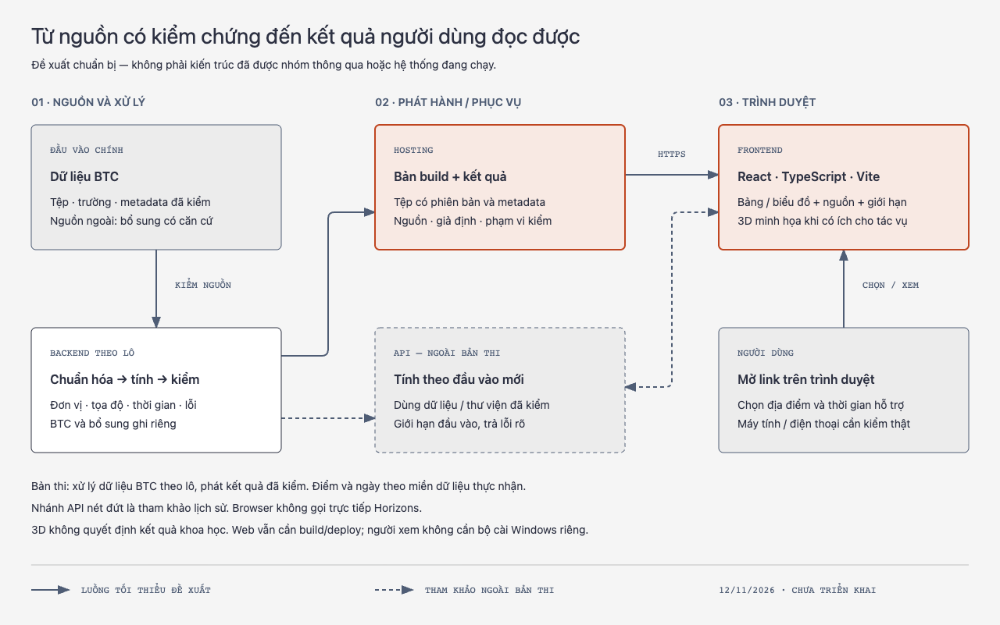
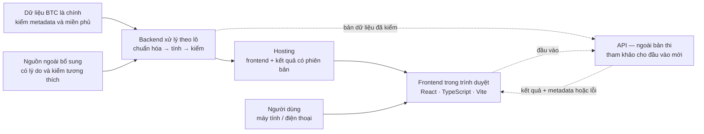

# Kiến trúc web app — bản đề xuất để nhóm trao đổi

**Bản sửa theo dữ liệu ngày 12/11:** [Moon Plan B](../../KE_HOACH_NHOM.md) mục 2–6 dùng bộ BTC làm nguồn chính, nguồn ngoài bổ sung có căn cứ; Python theo lô → JSON có phiên bản → React/Vite tĩnh. Địa điểm/ngày/cấu hình được chọn theo metadata và miền phủ thực nhận, không khóa trước. Mục tiêu là so lịch gốc/hoãn/ngày tiếp theo; nhánh API nét đứt không thuộc bản giao hiện tại. Mô hình tham chiếu có điều kiện dữ liệu, chưa được triển khai/kiểm định. Các đoạn thảo luận cũ dưới đây giữ vai trò lịch sử, kế hoạch mới là hướng thực hiện.

Ngày 12/11/2026, giờ Hà Nội. **Đề xuất chuẩn bị, chưa được cả nhóm chốt và chưa triển khai.**

**Phạm vi trao đổi mentor:** đã có sơ đồ thành phần, tương tác, luồng dữ liệu và mục 4 giải thích lý thuyết. Các tin nhắn dự thảo trong chat chia sẻ chưa gửi theo xác nhận của Sơn; không ghi nhận mentor/nhóm đã duyệt. Kế hoạch hiện tại mô tả mô hình tham chiếu có điều kiện, chưa có kết quả kiểm định.

## 1. Hướng đề xuất

Làm **web app responsive mở bằng đường link** trên trình duyệt máy tính/điện thoại. Frontend dùng React + TypeScript + Vite đã được chuẩn bị cho Sơn. Web vẫn có bước build frontend; người xem không cần bộ cài Windows riêng. Khả năng chạy trên từng thiết bị phải kiểm bằng sản phẩm thật. [MDN client/server](https://developer.mozilla.org/en-US/docs/Learn_web_development/Extensions/Server-side/First_steps/Client-Server_overview), [Vite production build](https://vite.dev/guide/build.html).

**Giả định để vẽ:** bản đầu cho người dùng xem một số địa điểm và khoảng thời gian có dữ liệu đã kiểm. Chỉ số khoa học, địa điểm, thời gian và kiểu so sánh còn chờ nhóm chọn. Ví dụ “một địa điểm ở hai thời điểm” hoặc “hai địa điểm trong cùng khoảng thời gian” là hai lựa chọn trao đổi, chưa phải hai tính năng bắt buộc.

Tách hai việc: **backend xử lý khoa học theo lô** tạo kết quả có phiên bản; **frontend** đọc và giải thích kết quả. Với tập lựa chọn hữu hạn, có thể phục vụ kết quả dạng tệp từ hosting, chưa cần API chạy thường trực. Nếu nhóm cần tính theo đầu vào mới, thêm một API hosted dùng dữ liệu/thư viện đã được kiểm. Cách tách này là khuyến nghị kỹ thuật, không phải yêu cầu của NASA.

## 2. Sơ đồ thành phần

Mở [sơ đồ trực quan](architecture.html). Đường liền là luồng tối thiểu đề xuất; đường đứt là nhánh API tham khảo lịch sử, ngoài bản thi Moon Plan B hiện tại. Các mũi tên chính mô tả đường dữ liệu/kết quả; thao tác người dùng được giải thích ở mục 3.

| Thành phần | Trách nhiệm và đầu ra |
| --- | --- |
| Nguồn | Bộ BTC là chính, có tệp/trường tham gia xử lý hoặc xác định đầu vào. Nguồn ngoài như Horizons/LOLA chỉ bổ sung khoảng thiếu có lý do và kiểm tương thích. Giữ URL, phiên bản, metadata và hash; chưa khóa địa điểm/ngày. |
| Backend xử lý theo lô | Lấy tập nhỏ theo điều khoản nguồn; thống nhất tọa độ, thời gian, đơn vị; thực hiện phép tính đã chọn; kiểm mẫu và dữ liệu thiếu. Xuất kết quả + metadata + báo cáo kiểm. Chỉ thực hiện sau giờ được phép bắt đầu. |
| Hosting | Phục vụ bản build, kết quả và tài nguyên có quyền sử dụng qua HTTPS; phiên bản frontend và dữ liệu phải tương thích. Cloudflare là ứng viên từ HOSTING_PLAN, chưa chốt nhà cung cấp/gói hoặc deploy. Mac không phải máy chủ public. |
| Frontend | Cho chọn trong miền được hỗ trợ; tải đúng phiên bản; hiển thị bảng/biểu đồ, nguồn và giới hạn. 3D là lớp minh họa tùy tác vụ; vẫn đọc được kết quả khi 3D lỗi. |
| API hosted, ngoài bản thi hiện tại | Chỉ thêm khi cần xử lý đầu vào chưa có kết quả lưu. Kiểm đầu vào và giới hạn khối lượng; dùng dữ liệu/thư viện đã kiểm; trả kết quả cùng metadata hoặc lỗi rõ. Không phải proxy mặc định tới Horizons. Stack backend do bên tích hợp cùng nhóm chọn. |

JPL hiện yêu cầu một request mỗi lần, tái sử dụng kết quả khi phù hợp, backoff, User-Agent hợp lệ và kiểm phiên bản; chính sách không cho nhúng API vào website. **Không vẽ browser gọi trực tiếp Horizons, không coi thêm proxy là đã giải quyết điều khoản.** Nhánh API của nhóm chỉ dùng nguồn đã xác minh được phép sử dụng theo cách đó. [JPL SSD API policy, đọc 12/11](https://ssd-api.jpl.nasa.gov/doc/index.php).

## 3. Người dùng và luồng dữ liệu

1. **Mở link:** hosting gửi frontend; ứng dụng đọc danh mục địa điểm/thời gian/chỉ số được hỗ trợ và phiên bản dữ liệu.
2. **Chọn tình huống:** người dùng chọn trong miền đã có dữ liệu; giao diện ghi rõ múi giờ. Chọn ngoài miền phải báo chưa hỗ trợ, không tự suy ra kết quả.
3. **Lấy kết quả:** frontend tải gói tương ứng; nếu nhánh API được chọn thì gửi đầu vào đã thống nhất và backend kiểm lại. Khi đổi lựa chọn, bỏ response cũ; hiển thị đang tải/lỗi/thử lại.
4. **Đọc kết quả:** bảng/biểu đồ và nguồn xuất hiện cùng đơn vị, thời gian, giả định, cảnh báo dữ liệu thiếu. Chỉ mở so sánh A/B nếu nhóm chọn luồng đó; không tự gán điểm “an toàn”.
5. **Kiểm chứng:** người xem mở nguồn và phương pháp. Nhóm truy lại được phiên bản dữ liệu và phép xử lý đã sinh ra kết quả; lỗi mạng không được biến thành giá trị 0 hoặc kết quả cũ không ghi nhãn.

**Hợp đồng bàn giao cần chốt trước khi tách việc** — đây là yêu cầu thông tin, chưa ấn định endpoint hay schema:

| Nhóm thông tin | Nội dung cần thống nhất |
| --- | --- |
| Đầu vào | ID/vị trí địa điểm, miền được hỗ trợ, quy ước tọa độ/cao độ; thời điểm hoặc khoảng thời gian và bước lấy mẫu. |
| Kết quả | Tên/ý nghĩa từng chỉ số, đơn vị, giá trị hợp lệ; phân biệt số 0, thiếu/NoData, kết quả một phần và lỗi. |
| Truy vết | Phiên bản hợp đồng, nguồn và sản phẩm, ngày lấy, hệ quy chiếu, thang thời gian, checksum, phiên bản phương pháp. |
| Độ tin cậy | Giả định, độ phân giải, độ bất định được biết, phạm vi kiểm mẫu; không tự bịa biên sai số nếu nguồn không cung cấp. |
| Hành vi giao tiếp | Ví dụ thành công/rỗng/lỗi, response cũ, timeout/retry, giới hạn kích thước; frontend và backend cùng xác nhận. |

## 4. Cơ sở lý thuyết và cách kiểm

Đọc [bản giải thích tiếng Việt — khoảng 8 phút](THEORY_PRIMER.md). Nội dung gồm:

1. Client/server và vì sao giao diện chạy đúng chưa chứng minh dữ liệu đúng.
2. Observer/target, hệ quy chiếu, mốc cao độ, thời gian và đơn vị; ý nghĩa tọa độ biểu kiến và `AIRLESS`.
3. Ephemeris so với DEM; chân trời lý tưởng so với địa hình che khuất; pixel so với độ bất định.
4. Chiếu sáng so với đủ điện; thấy Trái Đất so với khả năng liên lạc thực tế.
5. Kế hoạch kiểm khái niệm: metadata, đối chiếu có cùng định nghĩa, mức độc lập của nguồn và giới hạn kết luận.

Nguồn NASA/JPL/LOLA/NAIF/MDN được dẫn tại từng khẳng định và đọc lại ngày 12/11. Ví dụ là giả định để học. Đã bổ sung phần giải thích và kế hoạch kiểm, **chưa chọn/kiểm mô hình toán, chạy thuật toán hoặc tạo dataset**. Trước triển khai vẫn phải đọc header/product thực tế.

## 5. Bốn quyết định để nhóm chốt

1. **Một đầu ra demo:** người dùng chọn gì và cần nhận lại kết luận nào? Chọn một luồng trước, không mặc định phải có cả hai kiểu so sánh.
2. **Miền dữ liệu:** những địa điểm, khoảng thời gian và chỉ số nào được hỗ trợ, ai kiểm nguồn/phép tính?
3. **Cách chạy:** tệp kết quả có phiên bản có đủ không; chỉ cần API nếu câu trả lời là không. Ngân sách/nhà cung cấp bàn sau khi biết tải thực.
4. **Đường tích hợp:** repo/branch, người chốt hợp đồng và một ví dụ đầu vào → đầu ra có nguồn. Các phân công trên Sheet cần người nhận xác nhận; bản này không thay phân công.

**Câu trình bày 30 giây:** “Nhóm em đề xuất web app mở bằng trình duyệt. Phần xử lý dữ liệu lấy nguồn có trích dẫn, chuẩn hóa và kiểm kết quả rồi phát hành theo phiên bản. Frontend cho chọn địa điểm/thời gian trong phạm vi hỗ trợ, xem kết quả và nguồn; 3D giúp minh họa. Nếu cần tính đầu vào mới, nhóm mới thêm API. Phạm vi và hợp đồng dữ liệu đang chờ thống nhất.”

Nguồn yêu cầu: đoạn trao đổi mentor 12/11 do người dùng cung cấp trong chat, chưa xác thực độc lập. Không công khai nguyên văn hội thoại riêng. Kiến trúc là suy luận/khuyến nghị của Codex dựa trên HANDOFF, FRONTEND_HANDOFF, DATA_PREPARATION và HOSTING_PLAN; chưa phải quyết định toàn nhóm. Dùng Diagram Design, Context Mode và reviewer độc lập cho tài liệu. Bản sơ đồ là tài liệu chuẩn bị, không phải UI/art của bài nộp. Chưa viết code sản phẩm, deploy hoặc gửi tin cho nhóm.
